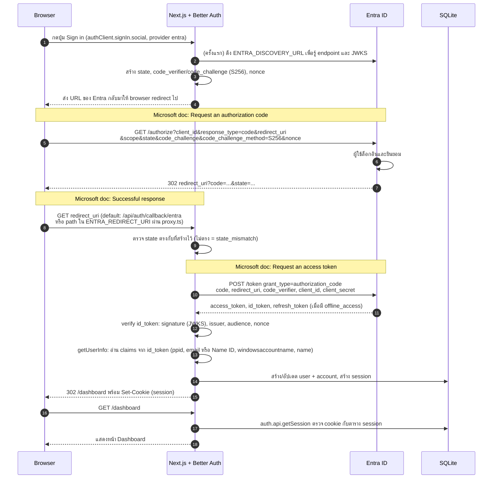

# Next.js + Better Auth + Microsoft Entra ID

โปรเจกต์ตัวอย่าง (reference project) สำหรับทำ Sign in with Microsoft Entra ID ด้วย Next.js App Router และ Better Auth โดยใช้ Authorization Code Flow with PKCE ตามเอกสารของ Microsoft: <https://learn.microsoft.com/en-us/entra/identity-platform/v2-oauth2-auth-code-flow>

ถ้าคุณต้องการเอาไปใส่ในโปรเจกต์ Next.js ที่มีอยู่แล้ว ให้อ่านต่อที่ [docs/PORTING-GUIDE.md](docs/PORTING-GUIDE.md)

## สารบัญ

1. [ภาพรวม](#1-ภาพรวม)
2. [คำตอบสั้นเรื่อง Callback URL](#2-คำตอบสั้นเรื่อง-callback-url)
3. [Flow การทำงาน](#3-flow-การทำงาน)
4. [เริ่มใช้งานกับ Mock IdP (5 นาที)](#4-เริ่มใช้งานกับ-mock-idp-5-นาที)
5. [จับคู่ค่าที่ได้จากผู้ดูแล -> .env](#5-จับคู่ค่าที่ได้จากผู้ดูแล---env)
6. [เลือกวิธีจัดการ Callback URL](#6-เลือกวิธีจัดการ-callback-url)
7. [ต่อกับ Entra ID จริง](#7-ต่อกับ-entra-id-จริง)
8. [การทดสอบอัตโนมัติ](#8-การทดสอบอัตโนมัติ)
9. [แก้ปัญหาที่พบบ่อย](#9-แก้ปัญหาที่พบบ่อย)
10. [โครงสร้างไฟล์](#10-โครงสร้างไฟล์)
11. [ข้อควรระวังสำหรับ Production](#11-ข้อควรระวังสำหรับ-production)

---

## 1. ภาพรวม

โปรเจกต์นี้คือแอปเล็ก ๆ ที่มีสองหน้า คือหน้าแรก (`/`) ที่มีปุ่ม "Sign in with Microsoft" และหน้า `/dashboard` ที่แสดงชื่อ อีเมล ppid (HRI_ID หรือ Student_ID) username และเวลาหมดอายุของ session เมื่อกด Sign in ระบบจะพาไปล็อกอินที่ Microsoft Entra ID แล้วกลับมาสร้าง session ให้ ข้อมูล user, account และ session ถูกเก็บใน SQLite

สิ่งที่คุณจะได้จากโปรเจกต์นี้:

- โค้ดที่ต่อ Entra ID เข้ากับ Better Auth ผ่าน plugin `genericOAuth` (providerId คือ `"entra"`) พร้อมการ verify id_token แบบเข้มงวด
- ตัวเลือกให้ใช้ Callback URL (redirect URI) ที่ผู้ดูแล Entra ลงทะเบียนไว้แล้วได้ โดยไม่ต้องแก้โค้ด เพียงตั้งค่า `ENTRA_REDIRECT_URI`
- Mock Entra ID (`mock-idp/server.mjs`) สำหรับลองทั้ง flow บนเครื่องโดยไม่ต้องมี tenant จริง
- ชุดทดสอบ end-to-end ด้วย Playwright 11 scenario ที่รันได้ด้วยคำสั่งเดียว

| ส่วนประกอบ | เวอร์ชัน / ค่า |
| --- | --- |
| Next.js (App Router) | 16.4.6 |
| Better Auth | 1.7.23 (plugin `genericOAuth`, providerId `entra`) |
| Better Auth CLI (`auth`, devDependency) | 1.7.23 |
| better-sqlite3 | 13.2.0 |
| jose (ใช้ decode id_token และใน mock IdP) | 6.2.17 |
| React / React DOM | 19.3.1 |
| TypeScript | 7.0.2 |
| Playwright (`@playwright/test`) | 1.63.0 |
| Mock Entra IdP | `http://127.0.0.1:4011` |

> **หมายเหตุเรื่อง Better Auth เวอร์ชันนี้** บทความหรือเอกสารเก่าหลายแห่งพูดถึง callback `/api/auth/oauth2/callback/:id` และการเรียก `signIn.oauth2` ซึ่ง **ใช้ไม่ได้แล้วใน Better Auth 1.7** callback เริ่มต้นของเวอร์ชันนี้คือ `{BETTER_AUTH_URL}/api/auth/callback/entra` และการ sign in เรียกผ่าน `authClient.signIn.social({ provider: "entra", ... })` (ดู `app/sign-in-button.tsx`)

---

## 2. คำตอบสั้นเรื่อง Callback URL

คำถามที่คุณน่าจะมี: ผู้ดูแล Entra ID ส่งค่ามา 6 อย่าง (Callback URL, Client ID, Client Secret, Authorize Endpoint, Token Endpoint, OpenID Metadata) แล้ว Callback URL ที่เขาลงทะเบียนไว้จะใช้กับ Better Auth ได้ไหม

**คำตอบ: ใช้ได้ ไม่ว่า path ที่ลงทะเบียนไว้จะเป็นอะไรก็ตาม** มีสองทางที่ถูกต้อง:

- **ทาง A** ให้ผู้ดูแลลงทะเบียน (เพิ่ม) URL เริ่มต้นของ Better Auth คือ `{BETTER_AUTH_URL}/api/auth/callback/entra` แล้วไม่ต้องตั้ง `ENTRA_REDIRECT_URI`
- **ทาง B** ใช้ URL ที่ผู้ดูแลลงทะเบียนไว้แล้ว เช่น `https://app.example.com/signin-oidc` โดยตั้ง `ENTRA_REDIRECT_URI` เป็นค่านั้นทุกตัวอักษร โปรเจกต์นี้จะส่งค่าดังกล่าวเป็น `redirect_uri` ทั้งใน authorize request และ token request และใช้ `proxy.ts` รับ callback ที่ path นั้นแล้วส่งต่อให้ Better Auth เอง ไม่ต้องแก้โค้ด

กติกาที่ต้องตรงกันไม่ว่าจะเลือกทางไหน:

1. ค่าที่ลงทะเบียนใน Entra กับค่า `redirect_uri` ที่แอปส่งไป ต้อง **ตรงกันทุกตัวอักษร** ทั้ง scheme, host, port, path และ trailing slash
2. platform type ของ redirect URI ใน Entra ต้องเป็น **Web** (เพราะแอปนี้ใช้ `client_secret` ซึ่งเป็น confidential client)
3. `http://` ใช้ได้เฉพาะ `localhost` ส่วนที่อื่นต้องเป็น `https://`
4. สำหรับทาง B: origin ของ `ENTRA_REDIRECT_URI` ต้องเท่ากับ origin ของ `BETTER_AUTH_URL` และห้ามมี query string หรือ fragment (ถ้าผิดแอปจะแจ้งตอน start server)

ตอน start server แอปจะพิมพ์บรรทัดนี้ให้ตรวจ ว่า URI ที่ใช้จริงคืออะไร (เอาค่านี้ไปเทียบกับที่ลงทะเบียนใน Entra):

```text
[auth] Redirect URI in effect (register this in Entra ID): http://localhost:3000/api/auth/callback/entra
```

รายละเอียดการเลือกทางอยู่ในหัวข้อ [6](#6-เลือกวิธีจัดการ-callback-url)

---

## 3. Flow การทำงาน

Flow นี้คือ authorization code flow with PKCE (PKCE คือกลไกป้องกันการขโมย authorization code: client สร้าง `code_verifier` แบบสุ่มแล้วส่งค่า hash ของมันเป็น `code_challenge` ไปก่อน ตอนแลก code ค่อยส่ง `code_verifier` ตัวจริง เพื่อให้ Entra ตรวจว่าเป็น client เดียวกัน)



ตารางด้านล่างจับคู่ขั้นตอนกับ Microsoft doc และไฟล์ที่รับผิดชอบ

| ขั้นตอน (ตาม Microsoft doc) | เกิดอะไรขึ้น | ไฟล์ที่เกี่ยวข้อง |
| --- | --- | --- |
| เริ่ม sign-in | client เรียก `authClient.signIn.social({ provider: "entra", callbackURL: "/dashboard", errorCallbackURL: "/" })` | `app/sign-in-button.tsx`, `lib/auth-client.ts` |
| Authorize request | Better Auth สร้าง URL ของ Entra พร้อม `state`, `code_challenge` (S256), `nonce` (ตามที่ `lib/auth.ts` ตั้ง `pkce: true`) และส่ง `redirect_uri` จาก `ENTRA_REDIRECT_URI` (หรือค่า default) | `lib/auth.ts`, `lib/env.ts`, `app/api/auth/[...all]/route.ts` |
| รับ authorization code | Entra redirect กลับมาที่ `redirect_uri` พร้อม `code` และ `state` ถ้าเป็น path แบบกำหนดเอง `proxy.ts` จะส่งต่อให้ Better Auth | `proxy.ts`, `lib/callback-forward.ts` |
| Token request | Better Auth ตรวจ `state` แล้วส่ง `code` + `code_verifier` + `client_secret` + `redirect_uri` (ค่าเดียวกับตอน authorize) ไปที่ token endpoint | `lib/auth.ts` (`genericOAuth`) |
| ตรวจ id_token | ตรวจ signature, issuer, audience, nonce (`requireIdTokenVerification: true` คือห้ามถอยไป decode แบบไม่ตรวจ) แล้วถึงเรียก `getUserInfo` | `lib/auth.ts` |
| สร้าง session | บันทึก user/account/session ลง SQLite และตั้ง cookie แล้ว redirect ไป `/dashboard` | `lib/auth.ts`, `app/dashboard/page.tsx` |

ทำไมต้องมี `proxy.ts` ในทาง B: Better Auth ใช้ path ของ request ที่เข้ามาเพื่อเลือก endpoint ถ้าใช้ rewrite ใน `next.config` ให้ `/signin-oidc` ไปที่ `/api/auth/callback/entra` handler จะยังเห็น path เดิมและตอบ **404** เพราะฉะนั้น `lib/callback-forward.ts` จึงสร้าง `Request` ใหม่ที่ชี้ไป `/api/auth/callback/entra` (คง query string `code`/`state` ไว้) แล้วเรียก `getAuth().handler(...)` ตรง ๆ และส่ง response (302 + Set-Cookie) กลับไปตามเดิม โดยแปลง `Location` ที่เป็น relative ให้เป็น absolute เพราะ Next.js ไม่ยอมรับ relative `Location` จาก `proxy.ts` (Next 16 เปลี่ยนชื่อ middleware เป็น `proxy`)

---

## 4. เริ่มใช้งานกับ Mock IdP (5 นาที)

ค่าใน `.env.example` ใช้กับ Mock IdP ได้ทันทีโดยไม่ต้องแก้

```bash
npm install
cp .env.example .env
```

> ใช้ `.env` ไม่ใช่ `.env.local` เพราะ Better Auth CLI (ที่ `npm run db:migrate` เรียกใช้) โหลดเฉพาะ `.env`

เปิด terminal แรกเพื่อรัน Mock IdP ค้างไว้:

```bash
npm run mock-idp
```

คุณควรเห็นข้อความประมาณนี้ (Mock IdP ล็อกอินให้ผู้ใช้ Ada Lovelace แบบอัตโนมัติ ไม่มีหน้าให้กรอกรหัสผ่าน):

```text
[mock-idp] Mock Entra ID listening on http://127.0.0.1:4011
[mock-idp]   ENTRA_DISCOVERY_URL=http://127.0.0.1:4011/11111111-2222-3333-4444-555555555555/v2.0/.well-known/openid-configuration
[mock-idp]   ENTRA_CLIENT_ID=00000000-0000-0000-0000-000000000001
[mock-idp]   ENTRA_CLIENT_SECRET=mock-client-secret
[mock-idp]   signs in as Ada Lovelace <ada@contoso.example> (auto-approve)
```

เปิด terminal ที่สอง สร้างตารางในฐานข้อมูล แล้วรันแอป:

```bash
npm run db:migrate
npm run dev
```

ตอน `npm run dev` start คุณควรเห็นบรรทัด `[auth] Redirect URI in effect (register this in Entra ID): http://localhost:3000/api/auth/callback/entra`

จากนั้นเปิด <http://localhost:3000> (ใช้ `localhost` ไม่ใช่ `127.0.0.1` เพราะ cookie ผูกกับ host ที่คุณเปิดใน browser ถ้าเปิดคนละ host กับ `BETTER_AUTH_URL` จะเกิด `state_mismatch`) กดปุ่ม **Sign in with Microsoft** แล้วคุณควรถูกพากลับมาที่ `/dashboard` พร้อมข้อมูลของ Ada Lovelace (Name, Email `ada@contoso.example`, PPID `10203040`, Username `ada.love`, เวลา Session expires) ส่วน terminal ของ Mock IdP จะพิมพ์ `authorize -> code issued` และ `token -> tokens issued` พร้อม `redirect_uri=` ที่ใช้

### ดูข้อมูลใน SQLite

ไฟล์ฐานข้อมูลคือค่า `DATABASE_PATH` (default `./dev.db` ที่ root ของโปรเจกต์) ตารางที่เกี่ยวข้องคือ `user`, `account`, `session`

ถ้ามี `sqlite3` ในเครื่อง:

```bash
sqlite3 dev.db ".tables"
sqlite3 -header -column dev.db 'SELECT id, email, name FROM "user";'
sqlite3 -header -column dev.db 'SELECT id, userId, providerId, accountId FROM "account";'
sqlite3 -header -column dev.db 'SELECT id, userId, expiresAt FROM "session";'
```

ถ้าไม่มี `sqlite3` ใช้ `better-sqlite3` ที่ติดตั้งอยู่แล้ว (รันจาก root ของโปรเจกต์):

```bash
node --input-type=module -e 'import D from "better-sqlite3"; const db = new D("dev.db", { readonly: true }); for (const t of ["user", "account", "session"]) { console.log(t); console.table(db.prepare(`SELECT * FROM "${t}"`).all()); }'
```

สิ่งที่ควรเห็นหลัง sign in หนึ่งครั้ง: `user` 1 แถว, `account` 1 แถวที่ `providerId = entra` และ `accountId` เท่ากับ `ppid` ของผู้ใช้ (แถว `user` มีคอลัมน์ `ppid` และ `username` ด้วย ในตาราง `account` `account` ยังเก็บ token ของ provider ด้วย จึงอย่า print ทั้งแถวในที่สาธารณะ) และ `session` 1 แถว เมื่อกด Sign out แถว `session` จะหาย ส่วน `user` กับ `account` ยังอยู่ และถ้า sign in ซ้ำจะใช้ `user`/`account` เดิม

### ลองแก้พฤติกรรมของ Mock IdP

Mock IdP มี endpoint สำหรับควบคุมระหว่างทดสอบ (ใช้ `curl` ตอนรัน `npm run mock-idp` ค้างไว้ได้):

```bash
curl http://127.0.0.1:4011/__log                      # ดู authorize/token request ที่เข้ามา
curl -X POST http://127.0.0.1:4011/__config -d '{"authorizeError":"access_denied"}'
curl -X POST http://127.0.0.1:4011/__reset            # คืนค่า default
```

---

## 5. จับคู่ค่าที่ได้จากผู้ดูแล -> .env

| ค่าที่ได้จากผู้ดูแล | ตัวแปรใน `.env` | จำเป็นไหม | ตัวอย่างรูปแบบค่าจริง |
| --- | --- | --- | --- |
| Callback URL | `ENTRA_REDIRECT_URI` (และเอา origin ไปใส่ `BETTER_AUTH_URL`) | ไม่จำเป็น: ไม่ตั้ง = ใช้ `{BETTER_AUTH_URL}/api/auth/callback/entra` | `https://app.example.com/signin-oidc` |
| Client ID | `ENTRA_CLIENT_ID` | จำเป็น | `<application-client-id-guid>` เช่น `aaaaaaaa-bbbb-cccc-dddd-eeeeeeeeeeee` |
| Client Secret | `ENTRA_CLIENT_SECRET` | จำเป็น | ต้องเป็น **secret value** (ไม่ใช่ secret ID) จากหน้า "Certificates & secrets" |
| OpenID Metadata | `ENTRA_DISCOVERY_URL` | จำเป็น | `https://login.microsoftonline.com/<tenant-id>/v2.0/.well-known/openid-configuration` |
| Authorize Endpoint | `ENTRA_AUTHORIZATION_URL` | ไม่จำเป็น (discovery ให้มาแล้ว) | `https://login.microsoftonline.com/<tenant-id>/oauth2/v2.0/authorize` |
| Token Endpoint | `ENTRA_TOKEN_URL` | ไม่จำเป็น (discovery ให้มาแล้ว) | `https://login.microsoftonline.com/<tenant-id>/oauth2/v2.0/token` |

ตัวแปรอื่นที่แอปต้องการ:

| ตัวแปร | จำเป็นไหม | ความหมาย |
| --- | --- | --- |
| `BETTER_AUTH_URL` | จำเป็น | origin สาธารณะของแอป (scheme + host + port ไม่มี path) เช่น `http://localhost:3000` แอปจะใช้เฉพาะส่วน origin |
| `BETTER_AUTH_SECRET` | จำเป็น | ยาวอย่างน้อย 32 ตัวอักษร ใช้เซ็น cookie และเข้ารหัส OAuth state สร้างด้วย `openssl rand -base64 32` |
| `DATABASE_PATH` | จำเป็น | path ของไฟล์ SQLite เช่น `./dev.db` |
| `ENTRA_SCOPES` | ไม่จำเป็น | คั่นด้วย space หรือ comma ค่า default `openid profile email offline_access` |
| `AUTH_RATE_LIMIT` | ไม่จำเป็น | ตั้งเป็น `off` เพื่อปิด rate limiter (ใช้ใน e2e เท่านั้น) |

ข้อควรระวัง:

- `ENTRA_DISCOVERY_URL` ต้องเป็นแบบ **tenant-specific** (มี tenant ID ไม่ใช่ `common` หรือ `organizations`) เพราะ issuer ของ `common`/`organizations` เป็น template ทำให้การ verify id_token ล้มเหลว ถ้าผู้ดูแลส่งแบบ `common` มา ให้ขอแบบที่มี tenant ID แทน
- แอปยังต้องมี `ENTRA_DISCOVERY_URL` เสมอ แม้ตั้ง `ENTRA_AUTHORIZATION_URL` และ `ENTRA_TOKEN_URL` เอง เพราะต้องใช้ JWKS และ issuer จาก discovery เพื่อ verify id_token
- ถ้าตัวแปรจำเป็นหายหรือค่าผิดรูป แอปจะ error ตอน start พร้อมชื่อตัวแปร เช่น `[config] Missing required environment variable ENTRA_CLIENT_ID (see .env.example)`

---

## 6. เลือกวิธีจัดการ Callback URL

| | ทาง A: ใช้ URL เริ่มต้นของ Better Auth | ทาง B: ใช้ URL ที่ผู้ดูแลลงทะเบียนไว้ |
| --- | --- | --- |
| `ENTRA_REDIRECT_URI` | ไม่ตั้ง | ตั้งเป็น URL ที่ลงทะเบียนไว้ทุกตัวอักษร |
| URL ที่ต้องลงทะเบียนใน Entra | `{BETTER_AUTH_URL}/api/auth/callback/entra` | URL เดิมของผู้ดูแล |
| ต้องให้ผู้ดูแลทำอะไร | เพิ่ม redirect URI ใหม่ (platform Web) | ไม่ต้องทำอะไรเพิ่ม |
| โค้ดที่ทำงาน | Better Auth รับ callback ตรง ๆ | `proxy.ts` + `lib/callback-forward.ts` ส่งต่อให้ Better Auth |
| ข้อจำกัด | ต้องรอผู้ดูแล | origin ต้องเท่ากับ `BETTER_AUTH_URL`, ไม่มี query/fragment |

ตัวช่วยตัดสินใจ:

| สถานการณ์ | แนะนำ |
| --- | --- |
| ลงทะเบียนแอปใหม่ ยังไม่มีใครผูก URL ไว้ | ทาง A |
| การแก้ registration ใน Entra ช้าหรือทำไม่ได้ | ทาง B |
| URL เดิมถูกใช้ร่วมกับแอปเก่า (เช่นแอปเดิมที่ใช้ `/signin-oidc`) และไม่อยากแตะ | ทาง B |
| อยากให้ path สั้นและเข้าใจง่ายโดยไม่พึ่ง proxy | ทาง A |

ตัวอย่างทาง B (`.env`):

```bash
BETTER_AUTH_URL=http://localhost:3000
ENTRA_REDIRECT_URI=http://localhost:3000/signin-oidc
```

วิธีตรวจว่าตั้งถูก: start แอปแล้วดูบรรทัดนี้ ค่าที่พิมพ์ต้องเหมือนกับที่ลงทะเบียนใน Entra (Authentication -> Web -> Redirect URIs) ทุกตัวอักษร

```text
[auth] Redirect URI in effect (register this in Entra ID): http://localhost:3000/signin-oidc
```

ถ้า origin ของ `ENTRA_REDIRECT_URI` ไม่ตรงกับ `BETTER_AUTH_URL` หรือมี `?`/`#` แอปจะหยุดพร้อมข้อความ `ENTRA_REDIRECT_URI origin (...) must match BETTER_AUTH_URL origin (...)` หรือ `ENTRA_REDIRECT_URI must not contain a query string or fragment` เหตุผลที่ origin ต้องตรงกันคือ callback ต้องลงที่แอปนี้เพื่อให้ cookie ของ state/PKCE ถูกส่งมาด้วย

(ถ้าตั้ง `ENTRA_REDIRECT_URI` เป็นค่าเดียวกับ default path ก็ได้ แอปจะส่งค่านั้นไปตามเดิมและ `proxy.ts` ไม่ต้องส่งต่ออะไร)

---

## 7. ต่อกับ Entra ID จริง

1. **ขอค่าจากผู้ดูแล** (ใช้ข้อความด้านล่าง)
2. ตัดสินใจทาง A หรือ B ตามหัวข้อ [6](#6-เลือกวิธีจัดการ-callback-url)
3. สร้าง `.env` (หรือตั้ง environment variable บน server) ตามตัวอย่างนี้:

   ```bash
   BETTER_AUTH_URL=http://localhost:3000
   BETTER_AUTH_SECRET=<ผลจาก openssl rand -base64 32>
   DATABASE_PATH=./dev.db
   ENTRA_CLIENT_ID=<application-client-id-guid>
   ENTRA_CLIENT_SECRET=<client-secret-value>
   ENTRA_DISCOVERY_URL=https://login.microsoftonline.com/<tenant-id>/v2.0/.well-known/openid-configuration
   # ทาง B เท่านั้น:
   ENTRA_REDIRECT_URI=http://localhost:3000/signin-oidc
   ```
4. หยุด Mock IdP (ไม่ต้องใช้แล้ว) แล้ว `npm run db:migrate` (ถ้ายังไม่เคยทำ) และ `npm run dev`
5. ดู log `[auth] Redirect URI in effect ...` เทียบกับที่ลงทะเบียนใน Entra
6. เปิด <http://localhost:3000> กด Sign in with Microsoft ล็อกอินด้วยบัญชีใน tenant แล้วตรวจว่ากลับมาที่ `/dashboard`
7. ถ้าผิดพลาด ดูตารางในหัวข้อ [9](#9-แก้ปัญหาที่พบบ่อย)

**ข้อความที่ copy ไปส่งให้ผู้ดูแล Entra ID ได้เลย:**

> สวัสดีครับ/ค่ะ ผมกำลังต่อแอป Next.js (Better Auth) เข้ากับ Entra ID รบกวนช่วยตรวจและส่งค่าต่อไปนี้ให้หน่อยครับ/ค่ะ
>
> 1. **Redirect URI**: ขอให้ลงทะเบียนใน Authentication ของ app registration ด้วย platform type เป็น **Web** (ไม่ใช่ SPA หรือ Mobile/desktop) ค่านี้ต้องตรงทุกตัวอักษร (scheme, host, port, path, trailing slash) ถ้าใช้ URL ที่ลงทะเบียนไว้แล้วอยู่ ช่วยยืนยันค่าที่แน่นอนอีกครั้งด้วยครับ/ค่ะ และถ้าทดสอบบนเครื่อง dev ขอเพิ่ม `http://localhost:3000/...` ด้วย (http ใช้ได้เฉพาะ localhost ส่วนที่อื่นต้องเป็น https)
> 2. **Application (client) ID**
> 3. **Client secret** ขอเป็น *secret value* (ไม่ใช่ secret ID) พร้อมวันหมดอายุ
> 4. **OpenID Connect metadata document** แบบ tenant-specific คือ `https://login.microsoftonline.com/<tenant-id>/v2.0/.well-known/openid-configuration` (ไม่ใช้ `common` หรือ `organizations`)
> 5. **Scopes / permissions**: `openid profile email offline_access` (delegated) และถ้าต้อง admin consent ช่วย grant ให้ด้วย
> 6. **Claims ใน ID token**: ขอให้ส่ง claim `ppid` (HRI_ID สำหรับบุคลากร / Student_ID สำหรับนักศึกษา), `windowsaccountname` และ `email` ใน **ID token** (ไม่ใช่แค่ access token) ถ้าไม่มี `email` แอปจะใช้ claim Name ID (ซึ่งคืนค่าอีเมล) แทน ส่วนถ้าไม่มี `ppid` แอปจะปฏิเสธการ sign-in
> 7. (ไม่บังคับ) Authorize endpoint และ Token endpoint ที่ใช้อยู่ ผมจะตรวจเทียบกับ metadata document
>
> ขอบคุณครับ/ค่ะ

พฤติกรรมเฉพาะของ Entra ที่โค้ดนี้จัดการไว้ให้:

| เรื่อง | สิ่งที่โค้ดทำ |
| --- | --- |
| email | ใช้ claim `email` ก่อน ถ้าไม่มีใช้ Name ID (`nameid`) ถ้าไม่มีทั้งคู่ผู้ใช้จะได้ error `email_not_found` |
| emailVerified | ตั้งเป็น `false` เสมอ เพราะ Entra ไม่ส่ง `email_verified` |
| account id | ใช้ claim `ppid` (HRI_ID / Student_ID) ไม่ใช้ `sub` ซึ่งเป็น pairwise ต่อแอป ถ้าไม่มี `ppid` จะปฏิเสธการ sign-in (`unable_to_get_user_info`) แทนที่จะเดาจาก claim อื่น |
| username | เก็บ claim `windowsaccountname` (name.sur ของบุคลากร / u69xxxxx, g69xxxxx ของนักศึกษา) ลงคอลัมน์ `user.username` และเก็บ `ppid` ลง `user.ppid` ด้วย ทั้งสองค่าอัปเดตทุกครั้งที่ sign-in |
| ชื่อ claim | อ่านได้ทั้งแบบชื่อสั้น (`ppid`, `nameid`, `windowsaccountname`, `email`) และแบบ ClaimType URI เต็ม (`http://schemas.xmlsoap.org/ws/2005/05/identity/claims/ppid` ฯลฯ) ดูใน `lib/claims.ts` |
| ห้ามแก้ ppid จาก client | field ที่ map จาก provider ต้องไม่ตั้ง `input: false` (ไม่งั้น Better Auth ไม่ยอมคัดลอกค่าให้) จึงปิด endpoint `/update-user` ผ่าน `disabledPaths` เพื่อไม่ให้ผู้ใช้ที่ล็อกอินแก้ `ppid`/`username` ของตัวเองได้ (มี e2e ตรวจ) |
| userinfo | ไม่เรียก userinfo (ของ Entra อยู่บน Microsoft Graph และมี claim น้อย) อ่านจาก id_token ที่ verify แล้ว |
| Sign out | ล้างเฉพาะ session ของแอป (`disableProviderLogout: true`) session SSO ของ Microsoft ยังอยู่ จึงอาจ sign in ซ้ำได้โดยไม่ถามรหัสผ่าน |

---

## 8. การทดสอบอัตโนมัติ

```bash
npm run test:e2e
```

ต้องว่างพอร์ต **4011, 3100, 3101** (ถ้าถูกใช้อยู่ สคริปต์จะหยุดพร้อมข้อความ `Port ... is in use` ให้หยุด `npm run mock-idp` / `npm run dev` ก่อน) ถ้า Playwright แจ้งว่าไม่พบ browser ให้ติดตั้งตามที่ Playwright บอก (เช่น `npx playwright install chromium`)

`scripts/e2e.mjs` ทำตามลำดับนี้ แล้วเก็บกวาดทุกอย่างตอนจบ:

1. สร้าง SQLite ชั่วคราวสองไฟล์ในโฟลเดอร์ temp
2. start Mock IdP ที่ `http://127.0.0.1:4011`
3. รัน migration ให้ทั้งสองฐานข้อมูล
4. `next build` (โดยไม่ตั้ง auth env ใด ๆ เพราะ config อ่านตอน runtime เท่านั้น)
5. start แอปสองตัวด้วย `next start`: `http://localhost:3100` (callback default) และ `http://localhost:3101` (`ENTRA_REDIRECT_URI=http://localhost:3101/signin-oidc`) ทั้งคู่ตั้ง `AUTH_RATE_LIMIT=off`
6. รัน Playwright (1 worker, Desktop Chrome)

**15 scenarios**

`e2e/default-callback.spec.ts` (14 ข้อ):

1. sign-in ถึง dashboard และใช้ `redirect_uri` เดียวกันทั้งสอง request (ตรวจ `response_type=code`, PKCE S256, `code_verifier` ถูก redact)
2. SQLite มีแถว user, account, session หลัง sign-in
3. session ยังอยู่หลัง reload
4. sign-out ลบ session และ `/dashboard` ถูกป้องกันอีกครั้ง
5. ผู้เยี่ยมชมที่ยังไม่ล็อกอินถูก redirect จาก `/dashboard` ไป `/`
6. id_token ไม่มี `email` -> fallback เป็น Name ID
7. claim ที่ส่งมาเป็น ClaimType URI เต็ม -> อ่านได้เหมือนกัน
8. id_token ไม่มี `ppid` -> ปฏิเสธ ไม่สร้าง session
9. ผู้ใช้ที่ล็อกอินแล้วแก้ `ppid`/`username` ผ่าน `/update-user` ไม่ได้ (404 และค่าใน DB ไม่เปลี่ยน)
10. เปลี่ยนชื่อ/username ที่ IdP แล้ว sign-in ใหม่ -> ค่าใน `user` อัปเดต แต่ยังเป็น user และ account เดิม
11. client secret ผิด -> แสดง error อ่านรู้เรื่องและไม่สร้าง session
12. IdP ส่ง `error=access_denied` -> แสดง error อ่านรู้เรื่อง ไม่มี token request
13. `state` ถูกแก้ไข -> ปฏิเสธ ไม่สร้าง session และไม่เรียก token endpoint
14. sign-in ครั้งที่สองใช้ user และ account เดิม แต่ session ใหม่

`e2e/custom-callback.spec.ts` (1 ข้อ):

15. sign-in ผ่าน `/signin-oidc` โดย `redirect_uri` เป็น path นั้นทั้งใน authorize และ token request และ sign-out ลบ session

**Control endpoints ของ Mock IdP** (`http://127.0.0.1:4011`)

| Endpoint | หน้าที่ |
| --- | --- |
| `GET /__log` | request ที่ `/authorize` และ `/token` เห็น (ปิดบัง `client_secret`, `code_verifier`, `refresh_token`) |
| `GET /__config` | ดูพฤติกรรมปัจจุบัน |
| `POST /__config` | merge JSON เข้า config: `user` (`oid`, `name`, `preferred_username`, `email`, `ppid`, `windowsaccountname`), `omitEmail`, `omitPpid`, `claimStyle` (`"short"` หรือ `"uri"`), `authorizeError` (เช่น `"access_denied"`), `clientSecret`, `tamperState` |
| `POST /__reset` | คืนค่า default ล้าง log และ code |

Mock IdP ปรับค่าได้ด้วย env: `MOCK_IDP_HOST` (default `127.0.0.1`), `MOCK_IDP_PORT` (default `4011`), `MOCK_IDP_TENANT_ID`, `MOCK_IDP_CLIENT_ID`, `MOCK_IDP_CLIENT_SECRET`

---

## 9. แก้ปัญหาที่พบบ่อย

| อาการ / error | สาเหตุ | วิธีแก้ |
| --- | --- | --- |
| `AADSTS50011` (reply URL ไม่ตรงกับที่ลงทะเบียน) | `redirect_uri` ที่แอปส่งไม่ตรงกับ redirect URI ใน Entra ทุกตัวอักษร (scheme, host, port, path, trailing slash) หรือลงทะเบียนผิด platform | ดู log `[auth] Redirect URI in effect ...` แล้วเทียบกับ Authentication ใน Entra ปรับ `ENTRA_REDIRECT_URI` หรือให้ผู้ดูแลลงทะเบียนค่านั้น (platform **Web**) |
| `AADSTS7000215` (invalid client secret) | `ENTRA_CLIENT_SECRET` ผิด เช่นใช้ secret ID แทน secret value | ใช้ **value** ของ secret (copy ได้ครั้งเดียวตอนสร้าง) ถ้าหายให้สร้างใหม่ แอปจะแสดง error code `invalid_code` |
| `AADSTS7000222` (client secret หมดอายุ) | secret ที่ใช้หมดอายุแล้ว | ขอ secret ใหม่จากผู้ดูแลแล้วอัปเดต `ENTRA_CLIENT_SECRET` (ดูหัวข้อ 11 เรื่องการหมุน secret) |
| `AADSTS700016` (ไม่พบ application) | `ENTRA_CLIENT_ID` ผิด หรือชี้ไปคนละ tenant กับ `ENTRA_DISCOVERY_URL` | ตรวจ client ID และ tenant ID ใน discovery URL ว่ามาจาก app registration เดียวกัน |
| `AADSTS50020` (บัญชีไม่มีใน tenant) | ล็อกอินด้วยบัญชีที่ไม่ได้อยู่ใน tenant ของแอป (เช่นบัญชีส่วนตัว หรือบัญชีจาก tenant อื่น) | ล็อกอินด้วยบัญชีของ tenant หรือให้ผู้ดูแลเชิญ/ปรับ audience ของแอป |
| `invalid_grant` ตอน token request | code ถูกใช้ไปแล้วหรือหมดอายุ, `redirect_uri` ใน token request ไม่ตรงกับตอน authorize, หรือ `code_verifier` ไม่ตรง `code_challenge` | ลอง sign in ใหม่ตั้งแต่ต้น (code ใช้ได้ครั้งเดียว) และตรวจว่า `ENTRA_REDIRECT_URI` ไม่เปลี่ยนระหว่างทาง แอปจะแสดง `invalid_code` |
| `state_mismatch` / `state_not_found` / `please_restart_the_process` | cookie ของ state ไม่ถูกส่งมา: เปิดแอปด้วย `127.0.0.1` แต่ `BETTER_AUTH_URL` เป็น `localhost` (หรือกลับกัน), หรือ host ของ redirect URI ไม่ตรงกับ `BETTER_AUTH_URL`, หรือ state ถูกแก้ไข/หมดอายุ | เปิดแอปด้วย host เดียวกับ `BETTER_AUTH_URL` (`http://localhost:3000`) และให้ origin ของ `ENTRA_REDIRECT_URI` ตรงกับมัน |
| issuer mismatch / id_token verify ไม่ผ่าน (`unable_to_get_user_info`) เมื่อใช้ `common` | `ENTRA_DISCOVERY_URL` เป็น `common` หรือ `organizations` ซึ่ง issuer เป็น template ไม่ตรงกับ issuer จริงใน token | เปลี่ยนเป็น discovery URL แบบ tenant-specific: `https://login.microsoftonline.com/<tenant-id>/v2.0/.well-known/openid-configuration` |
| `[config] Missing required environment variable ...` หรือ `... is not a valid absolute URL` | ตัวแปรหายหรือไม่ใช่ URL | ดูชื่อตัวแปรในข้อความ แล้วเติมใน `.env` (หรือ environment ของ server) แล้ว restart |
| `[config] BETTER_AUTH_SECRET must be at least 32 characters long` | secret สั้นเกินไป | สร้างใหม่ด้วย `openssl rand -base64 32` |
| `[config] ENTRA_REDIRECT_URI origin (...) must match BETTER_AUTH_URL origin (...)` | origin ไม่ตรงกัน | แก้ให้ scheme/host/port ตรงกัน |
| `429 Too Many Requests` | rate limiter ของ Better Auth เปิดอยู่ใน production (กดซ้ำหลายครั้งในเวลาสั้น ๆ) | รอสักครู่แล้วลองใหม่ (`AUTH_RATE_LIMIT=off` ใช้เฉพาะตอนทดสอบ ห้ามใช้ใน production) |
| 404 ที่ path callback แบบกำหนดเอง (เช่น `/signin-oidc`) | ใช้ rewrite ใน `next.config` แทน forwarder, หรือไม่มี `proxy.ts`, หรือ path ใน `ENTRA_REDIRECT_URI` ไม่ตรงกับ path ที่ Entra redirect มา | ใช้ `proxy.ts` + `lib/callback-forward.ts` ตามที่โปรเจกต์นี้ทำ และตรวจว่า path ตรงกัน |
| 404 ที่ `/api/auth/oauth2/callback/entra` | ใช้ path ของ Better Auth เวอร์ชันเก่า | path ที่ถูกของ 1.7 คือ `/api/auth/callback/entra` (หรือ path ของ `ENTRA_REDIRECT_URI`) |

error code ที่แอปนี้แสดงบนหน้าแรก (นิยามใน `app/sign-in-errors.ts`) รหัสอื่นที่ไม่อยู่ในตารางจะแสดงข้อความ "Sign-in failed. Please try again." พร้อม `Error code` ให้ดู

| Error code | ข้อความที่แสดง (ย่อ) | ต้องตรวจอะไร |
| --- | --- | --- |
| `access_denied` | ยกเลิกการ sign-in หรือถูก Microsoft ปฏิเสธ | ผู้ใช้กดยกเลิก หรือ tenant/แอปไม่อนุญาต (ตรวจ consent) |
| `invalid_code` | Entra ปฏิเสธการแลก authorization code | `ENTRA_CLIENT_ID`, `ENTRA_CLIENT_SECRET`, redirect URI ที่ลงทะเบียน |
| `state_mismatch` | ตรวจ state ไม่ผ่าน | ดูแถว `state_mismatch` ด้านบน |
| `state_not_found` | ไม่พบ state | cookie หาย / host ไม่ตรง |
| `please_restart_the_process` | คำขอหมดอายุหรือถูกแก้ไข | ลอง sign in ใหม่ |
| `unable_to_get_user_info` | ตรวจ id_token ไม่ผ่านหรือไม่มี claim `ppid` | discovery URL แบบ tenant-specific และขอให้ผู้ดูแลส่ง claim `ppid` ใน ID token |
| `email_not_found` | ไม่มีทั้ง claim `email` และ Name ID | ขอให้ผู้ดูแลส่ง claim `email` (หรือ Name ID) ใน ID token |
| `oauth_provider_not_found` | ไม่พบ provider Entra | ตรวจ `ENTRA_DISCOVERY_URL` และว่าเข้าถึง IdP ได้จาก server |

---

## 10. โครงสร้างไฟล์

```text
.
├── .env.example                  ตัวอย่าง environment variable (copy เป็น .env)
├── package.json                  dependency และ script ทั้งหมด
├── next.config.ts                serverExternalPackages: better-sqlite3 (native module)
├── proxy.ts                      รับ callback path ที่กำหนดเองแล้วส่งต่อให้ Better Auth
├── instrumentation.ts            ตอน start: ตรวจ env และพิมพ์ Redirect URI ที่ใช้จริง
├── playwright.config.ts          ตั้งค่า Playwright (1 worker)
├── lib/
│   ├── env.ts                    อ่านและตรวจ env แบบ lazy พร้อมข้อความ error ชัดเจน
│   ├── claims.ts                 อ่าน claims ของผู้ใช้ (ppid, windowsaccountname, email, Name ID) จาก id_token
│   ├── auth.ts                   ตั้งค่า Better Auth + genericOAuth (providerId "entra")
│   ├── auth-client.ts            authClient สำหรับฝั่ง browser
│   └── callback-forward.ts       ส่งต่อ request จาก custom callback path ไป /api/auth/callback/entra
├── app/
│   ├── layout.tsx                layout หลัก
│   ├── globals.css               สไตล์
│   ├── page.tsx                  หน้าแรก: ปุ่ม sign-in และแสดง error
│   ├── sign-in-button.tsx        เรียก authClient.signIn.social
│   ├── sign-in-errors.ts         แปลง error code เป็นข้อความ
│   ├── dashboard/
│   │   ├── page.tsx              หน้าที่ป้องกันด้วย auth.api.getSession
│   │   └── sign-out-button.tsx   เรียก authClient.signOut
│   └── api/auth/[...all]/route.ts  route handler ของ Better Auth (GET/POST)
├── mock-idp/server.mjs           Mock Entra ID สำหรับ demo และ e2e
├── scripts/e2e.mjs               สคริปต์รัน e2e ครบวงจร (npm run test:e2e)
├── e2e/
│   ├── helpers.ts                ตัวช่วย: ควบคุม mock IdP, sign-in/out, อ่าน SQLite
│   ├── default-callback.spec.ts  14 scenarios (callback default)
│   └── custom-callback.spec.ts   1 scenario (/signin-oidc)
└── docs/PORTING-GUIDE.md         คู่มือนำไปใส่โปรเจกต์อื่น
```

---

## 11. ข้อควรระวังสำหรับ Production

- **ใช้ HTTPS** `BETTER_AUTH_URL` และ redirect URI ต้องเป็น `https://` (http ใช้ได้เฉพาะ `localhost` ตามกติกาของ Entra)
- **จัดการ secret ให้ดี** ห้าม commit `.env` (มีใน `.gitignore` แล้ว) เก็บ `BETTER_AUTH_SECRET` และ `ENTRA_CLIENT_SECRET` ใน secret store ของแพลตฟอร์ม client secret มีวันหมดอายุ ควรจดวันหมดอายุไว้ และหมุนเปลี่ยนก่อนหมด (ถ้าหมดจะเจอ `AADSTS7000222`) ส่วน `BETTER_AUTH_SECRET` ต้องยาวอย่างน้อย 32 ตัวอักษร
- **ใช้ฐานข้อมูลจริงแทน SQLite** SQLite ในตัวอย่างนี้เหมาะกับ demo เท่านั้น ใน production ให้ใช้ฐานข้อมูลที่รองรับหลาย instance (ดู [docs/PORTING-GUIDE.md](docs/PORTING-GUIDE.md) หัวข้อการเปลี่ยน database ซึ่งโปรเจกต์นี้ **ไม่ได้ทดสอบ** กับฐานข้อมูลอื่น)
- **`BETTER_AUTH_URL` หลัง reverse proxy** ต้องเป็น origin สาธารณะที่ผู้ใช้เห็นจริง (เช่น `https://app.example.com`) ไม่ใช่ address ภายใน และ origin ของ `ENTRA_REDIRECT_URI` ต้องตรงกัน แอปใช้เฉพาะส่วน origin (ไม่รองรับ path prefix ใน `BETTER_AUTH_URL`)
- **ห้ามนำ Mock IdP ขึ้น production** และห้ามตั้ง `AUTH_RATE_LIMIT=off` (ใช้ใน e2e เท่านั้น)
- **Sign out เป็นแบบ app-only** ล้างเฉพาะ session ของแอป session ของ Microsoft ยังอยู่ ผู้ใช้จึงกด Sign in ซ้ำแล้วเข้าได้ทันทีถ้า Microsoft session ยังไม่หมดอายุ ถ้าต้องการ global logout ต้องออกแบบเพิ่มเอง (ตอนนี้ตั้ง `disableProviderLogout: true`)
- **ตรวจ `[auth] Redirect URI in effect` ทุกครั้งที่ deploy** ให้ตรงกับที่ลงทะเบียนใน Entra
